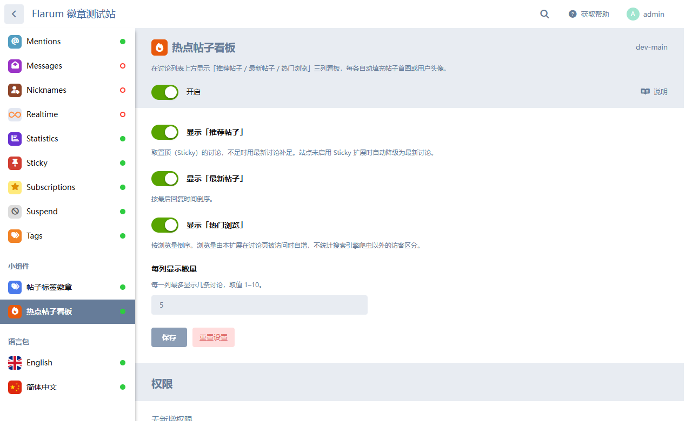

# 热点帖子看板 · Flarum Hot Board

在讨论列表上方显示三列看板：**推荐帖子 / 最新帖子 / 热门浏览**。
每条自动填充缩略图（帖子正文里的第一张图，取不到则用用户头像），不会出现空白圆圈。


## 特性

- **三列看板**：推荐 / 最新 / 热门，每列可独立开关，也能只留一列
- **永不空白的缩略图**：优先正文首图 → 回退用户头像（无头像时渲染首字母 + 用户组颜色）
- **图片模式**：任意单列可切换成图片轮播，标题叠加在图片底部（带渐变遮罩）
- **近 7 天浏览量**：热门列按最近 7 天统计，而不是全站累计，由每日定时任务滚动窗口
- **高度锁定**：每列 5–10 条可选，**区块高度恒定不变**，翻页/切换配置不会跳动
- **骨架屏**：首次加载显示同尺寸骨架，返回列表不闪加载态（60 秒内存缓存）
- **手动推荐**：后台填讨论 ID 即可指定推荐列表及顺序，不足时用置顶/最新补足
- **访客可关闭**：右上角 `×` 隐藏看板，本机 localStorage 记住，不影响他人
- **全中文/英文语言包**，深色模式适配

| 5 条（两行布局） | 后台设置 |
|---|---|
|  |  |

## 环境要求

| 项 | 要求 |
|---|---|
| Flarum | **2.0+**（不兼容 1.x） |
| PHP | 8.1+ |
| 扩展 `flarum-sticky` | 可选。「推荐」列的置顶优先依赖它，未装则自动退化为「最新」 |
| Node.js | **不需要**。`js/dist/` 已构建并随仓库提供 |

## 安装

### 方式一：Composer（推荐）

在你的 Flarum 根目录，先告诉 Composer 去哪里找（本包未发布到 Packagist）：

```bash
composer config repositories.yingweigan-hot-board vcs https://github.com/yingweigan/acme-flarum-hot-board.git
```

然后安装：

```bash
composer require yingweigan/flarum-hot-board
```

启用：

```bash
php flarum extension:enable yingweigan-hot-board
php flarum migrate
php flarum cache:clear
```

> 也可以直接用 `composer.json` 手写，效果一样：
>
> ```json
> {
>     "repositories": [
>         { "type": "vcs", "url": "https://github.com/yingweigan/acme-flarum-hot-board.git" }
>     ]
> }
> ```

### 方式二：手动放入

下载仓库，把目录放到 `packages/yingweigan-hot-board/`，然后在 `composer.json` 加：

```json
"repositories": [{ "type": "path", "url": "packages/*" }]
```

```bash
composer require yingweigan/flarum-hot-board:@dev
php flarum extension:enable yingweigan-hot-board
php flarum migrate
php flarum cache:clear
```

## ⚠️ 必须配置定时任务

扩展注册了一个每天 03:10 执行的重算命令：

```bash
php flarum yingweigan-hot-board:recount
```

**没有 cron 触发，「近 7 天」会退化成「自安装以来」**——计数只增不减，窗口不会滚动。

```cron
* * * * * cd /path/to/flarum && php flarum schedule:run >> /dev/null 2>&1
```

验证：

```bash
php flarum schedule:list        # 应看到 10 3 * * * yingweigan-hot-board:recount
php flarum yingweigan-hot-board:recount   # 手动跑一次确认可用
```

## 后台设置

`/admin#/extension/yingweigan-hot-board`

| 设置 | 说明 | 默认 |
|---|---|---|
| 显示「推荐帖子」 | 开关 | 开 |
| 推荐列表来源 | 讨论 ID，逗号分隔，顺序即展示顺序（留空 = 置顶优先 + 最新补足） | 空 |
| 显示「最新帖子」 | 开关 | 开 |
| 显示「热门浏览」 | 开关 | 开 |
| 每列显示数量 | **5–10** | 5 |
| 各列显示方式 | 列表 / 图片 | 列表 |
| 轮播间隔 | 2–30 秒，仅图片模式 | 5 |
| 允许访客关闭看板 | 本机 localStorage | 开 |

## 数据表变更

安装时执行两个迁移：

| 迁移 | 作用 |
|---|---|
| `add_view_count_to_discussions` | `discussions.view_count`（全站累计） |
| `add_recent_view_tracking` | `discussions.view_count_recent`（近 7 天）+ `acme_hot_board_view_days` 明细表 |

每次讨论页被访问会写入 3 次：两个计数各 +1，以及当天明细 +1。

> SQLite 在高并发下有写锁瓶颈；流量较大建议使用 MySQL。

## 卸载

```bash
php flarum extension:disable yingweigan-hot-board   # 只隐藏，保留数据
# 彻底移除
composer remove yingweigan/flarum-hot-board
php flarum migrate:reset yingweigan-hot-board
```

## 开发

```bash
cd js
npm install
npm run dev     # 开发监听
npm run build   # 生产构建，产物在 js/dist/
```

**改了 `js/src/` 或 `less/` 之后必须重新构建并提交 `js/dist/`**，否则使用方拿到的是旧前端。

更多内部实现（高度锁定的原理、缓存策略、7 天窗口的存储设计、踩坑记录）见 [DEVELOPMENT.md](DEVELOPMENT.md)。

## 许可证

[MIT](LICENSE)
